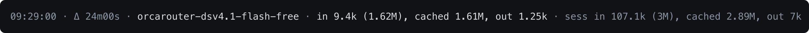
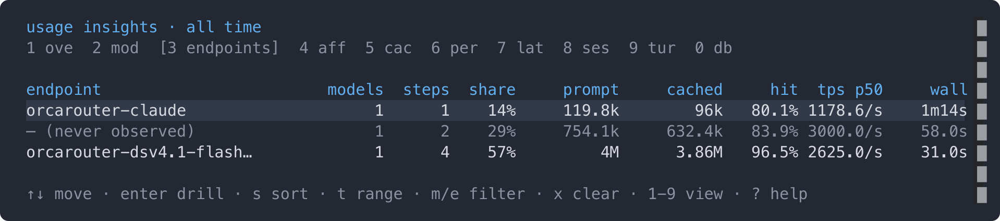

# opencode-usage-insights 📊

[](https://github.com/hugobatista/opencode-usage-insights/releases)
[](https://github.com/hugobatista/opencode-usage-insights/actions/workflows/test.yml)
[](https://github.com/hugobatista/opencode-usage-insights/actions/workflows/lint.yml)
[](https://www.npmjs.com/package/opencode-usage-insights)

OpenCode plugin for one question the host cannot answer: **which endpoint is
actually serving each model** — and what that costs. It shows a telemetry line
above the composer after every finished turn and records every assistant step
in a local SQLite file, read back through an interactive `/usage` panel.



Everything stays local: one SQLite file under the OpenCode state directory,
written by the server-side recorder and read by the TUI.

## What it does

- **The line** (`session.composer.top`): end time, the gap since the previous
  prompt, the endpoint that served the turn, turn and session token totals, and
  warnings when the prompt cache or the endpoint identity changed. It belongs to
  finished work, so it stays hidden while a turn is running.
- **The `/usage` panel**: ten keyboard-driven views — `overview`, `models`,
  `endpoints`, `affinity`, `cache`, `periods`, `latency`, `sessions`, `turns`,
  `db` — over five ranges (`session`, `today`, `7d`, `30d`, `all`), with
  drill-downs, sorting, filters and state remembered between openings.
  `/usage models 7d`, `/usage affinity`, `/usage endpoints 30d`.
- **The session sidebar**: the session's own totals and its last turns, in the
  same buckets as the line. Three lines per turn — when and through what, the
  prompt volumes, then `hit · tok/s · cost` — and the session's average
  throughput on its totals:
  `16:54 orcarouter-dsv4.1flash` / `in 1.7k (427.3k) · out 1.06k` /
  `hit 99.7% · 1.2k/s · $0.0006`.
- **The record** (server entry): every assistant step with tokens, cost,
  timings, finish reason, provider/model, session and parent ids, and the
  endpoint that served it; prompts, session lifecycle and compaction events too.
- **Portable data** (from a checkout): `bun run report --ndjson` exports the
  whole database, and `--import` merges it back on another machine.
- **Observational by design**: the plugin never rewrites prompts, requests or
  responses, and a failure inside the recorder is swallowed — telemetry can
  never interrupt a session.

## Requirements

- **OpenCode V2** (`>=2.0.0`). The V2 release changed the plugin API (slots,
  panels, event stream).
- [Bun](https://bun.sh) to install dependencies (development only).

| | |
| --- | --- |
| **OS** | Linux, macOS and Windows. The database lives in the per-user state directory of each (table below). CI runs the data layer — paths, database, recorder, queries, panel assembly, dump round-trip, file permissions — on all three, and the whole suite (including the TUI render tests) on Linux. `bun run check:platform` runs that same check by hand. |
| **Runtime** | Bun, the runtime OpenCode ships with. SQLite comes from `bun:sqlite`: there is no native module to build and nothing to compile on install. |

## Install

> [!IMPORTANT]
> **Not on the npm registry yet.** Until the first release is published,
> `opencode plugin add` and the package-name form below cannot resolve it — use
> the local checkout, the last form of this section.

```sh
opencode plugin add opencode-usage-insights
```

Or add the package to `~/.config/opencode/opencode.jsonc` (server entry) and
`~/.config/opencode/cli.json` (TUI entry):

```jsonc
// ~/.config/opencode/opencode.jsonc
{
  "$schema": "https://opencode.ai/config.json",
  "plugins": ["opencode-usage-insights"]
}
```

```jsonc
// ~/.config/opencode/cli.json
{
  "$schema": "https://opencode.ai/v2/cli.json",
  "plugins": ["opencode-usage-insights"]
}
```

To pass [options](#configuration), use the object form:

```jsonc
{
  "plugins": [
    { "package": "opencode-usage-insights", "options": { "identity": "endpoint" } }
  ]
}
```

Or register a local checkout. V2 resolves a local *directory* plugin through its
entry files, so pointing at `src/` loads the server recorder (`src/index.ts`)
and the TUI contributions (`src/tui.tsx`) from source:

```jsonc
// ~/.config/opencode/opencode.jsonc
{ "plugins": [{ "package": "/home/you/code/projects/opencode-usage-insights/src" }] }
```

```jsonc
// ~/.config/opencode/cli.json
{ "plugins": [{ "package": "/home/you/code/projects/opencode-usage-insights/src" }] }
```

Configuration changes reload on their own; after changing the plugin's source,
restart the background service with `opencode service restart`.

Send a prompt to verify: the telemetry line appears above the composer when the
turn finishes, and `/usage` (alias `/insights`) opens the panel.

## The line

```text
14:32:07 · Δ 3m12s · orcarouter-dsv4.1-flash-free · in 85.4k (1.62M), cached 1.53M, out 3.7k · sess in 2.1M (14.5M), cached 12.4M, out 88k · ⚠ cache expired (−11.7k)
```

| Segment | Meaning |
| --- | --- |
| `14:32:07` | When the response ended (`completed`, else `streamed`, else `created`). |
| `Δ 3m12s` | Time since the previous prompt of the same session. |
| `orcarouter-dsv4.1-flash-free` | The endpoint that served the turn (`identity: "endpoint"`, the default): the gateway names it in a response header, or the request host names the operator. Without one the segment falls back to `providerID/modelID` (variant as a trailing word); `identity: "model"` always shows that form. Yellow with `changed` when it differs from the previous prompt. |
| `in 85.4k (1.62M), cached 1.53M, out 3.7k` | `in` is the uncached part of the prompt (fresh input + cache writes), the parenthesised value the whole prompt — shown only when the two differ — `cached` its cached part, and `out` everything generated (visible output + reasoning). With several steps the segment reads `3 steps · …` and reports the step the turn ended with (`latest`); `turnTotals: "sum"` adds every step instead. |
| `sess in 2.1M (14.5M), cached 12.4M, out 88k` | The session totals reported by the host, in the same buckets. |
| `⚠ cache expired (−11.7k)` | Yellow. The prompt cache read fell by that many tokens against a comparable previous step; `×N` when several steps in the turn lost cache. |

The turn segment carries no label by default — the numbers are the turn's, and
`sess` marks the session's; `labels.turn` (e.g. `"turn"`) brings a prefix back.

A turn is every consecutive assistant step after a prompt. Compaction, shell,
`idle` and info messages do not split a turn; `user`, `synthetic` and `system`
messages do. From a checkout, `bun run demo` prints one example per case,
including the streaming one and both turn-total views.

## The panel

`/usage [view] [range]` opens the panel (`/usage` alone opens the last view, or
`overview` over `all` the first time). While the panel is open it owns input, so
the prompt cannot take the command again: `escape` closes it, `f` toggles full
screen, and the palette entry (`ctrl+p` → "Usage insights") toggles it closed.
With the composer focused, `/usage` with no arguments also toggles it closed,
and any argument — including an unknown token, which is ignored — keeps it open.
There is no default key binding — the command is palette-only, so it never
shadows a key you use.



The view bar at the top names every view and brackets the active one; `?` opens
a help overlay that repeats the keys and defines every number.

### Keys

| Key | Does |
| --- | --- |
| `↑` `↓` / `j` `k` | Move the cursor; the row under it is highlighted. |
| `pageup` `pagedown` / `home` `end` | Move by ten rows / to the first or last row. |
| `enter` | Drill into the row: a model → the endpoints that served it and its affinity; an endpoint → the models it served and its latency; a session → its turns; a period → the models of the period. In `db`, prune the steps older than the row (asks first). |
| `backspace` | Go back from a drill-down. |
| `0`–`9` / `[` `]` | Pick a view (`0` is `db`) / cycle views. |
| `t` / `shift+t` | Next / previous range. |
| `s` / `shift+s` | Cycle the sort column / reverse it. |
| `b` | `periods` bucket: day → week → month. |
| `a` | `turns` scope: this session ↔ every session. |
| `m` `e` | Filter by model or by **endpoint** (a picker of the values actually observed). |
| `x` | Clear the filters. |
| `r` | Re-read the database. |
| `v` | `db`: compact the file, giving the space of deleted rows back. |
| `?` | Help overlay. |
| `f` / `escape` | Full screen / close. |

The view, range, sort, bucket, scope and filters are stored through the host's
durable storage, so the panel reopens where it was left.

### Views

| View | Answers |
| --- | --- |
| `overview` | Steps, sessions, prompts, `in`/`cached`/`write`/`out`, `hit`, cost, an activity sparkline, a `this session` block and a **data coverage** block (how many steps lack a model, an endpoint or a completion — a zero elsewhere is only trustworthy when this is complete). |
| `models` | Every model with its cache (`hit` and the per-step `hit p50`), tokens, cost, the **endpoints that actually served it** and how often its identity changed. `enter` opens the per-endpoint detail. |
| `endpoints` | **Who served the work**: one row per routing endpoint, with the models it served, steps, share, prompt, cached, `hit`, p50 throughput, wall time and cost. `enter` lists every model it served. A request whose endpoint was never observed is dimmed — the panel does not invent an identity. |
| `affinity` | How often the step's identity changed against the step before it in the same session — the model and the endpoint — the cache those changes cost, and the most frequent transitions. |
| `cache` | Reuse by model, losses grouped by reason (`expired`, `compaction`, `unknown`), **cache survival against idle time**, reuse kept per endpoint, the observed TTL bounds (`hits up to` / `drops from`) and the most recent losses. |
| `periods` | Day, week or month totals — steps, sessions, `in`, `cached`, `write`, `hit`, `out`, cost — with a sparkline per metric and a totals row. `enter` lists the models of a period. |
| `latency` | Wall time, streaming window and throughput as p50/p90/p99 overall and per model (per endpoint when a model is filtered). `n < 5` is dimmed. |
| `sessions` | Each session with steps, prompts, tokens, `hit`, cost, its directory and how many models it used; subagent sessions are indented under their parent and rolled up. |
| `turns` | The per-prompt history: one line per finished turn, rendered exactly like the live line. `a` widens it to every session, titled. |
| `db` | Where the file lives, what it holds and how much of it is old. `enter` prunes a retention, `v` gives the space back. |

The panel sums the stored per-step buckets over the selected range, so a number
read in one place means the same in the other: `prompt` is everything the
provider saw (`cached + fresh + writes`), `in` the uncached part, `hit` is
`cached / prompt`, and `out` everything generated (visible output + reasoning).

The endpoint is what the gateway names in `x-opencode-endpoint-id`, or the host
of a per-operator provider. A **gateway host is not an endpoint**: when the
gateway names no downstream endpoint, the request has no observed endpoint and
the views say so (`– (never observed)`) instead of showing the gateway's name as
if it had run the model. The line and the sidebar then fall back to
`provider/model`. The line reports the endpoint of the turn it belongs to: a
turn the gateway did not name falls back even when an earlier turn of the same
provider and model had an endpoint.

`tps`/`wall`/`stream` are produced tokens per streaming second / request to
completed step / request to the last chunk. The sidebar's rate (per turn, and
the session average on its totals) is the **weighted** one — produced tokens
divided by the summed streaming windows — so it answers "how fast did this
produce"; the `latency` view reports the p50 of the per-step rates instead, which
answers "how fast is a typical step". A change of identity is not by
itself a fault — a gateway may re-route deliberately — so `affinity` pairs the
count with the cache reuse it actually cost. The panel's `?` overlay defines
every number in place.

## Configuration

Options apply to both entries (each side reads the ones it needs):

| Option | Default | Meaning |
| --- | --- | --- |
| `enabled` | `true` | `false` disables that side completely — no line, no panel, no recording. |
| `db` | per-OS state path | SQLite path override. Must match between the server and TUI entries. |
| `turnTotals` | `"latest"` | How the turn segment counts prompt usage: `latest` shows the prompt size the turn ended with; `sum` adds every step of the turn. |
| `sidebar` | `true` | Show the session summary and the per-prompt history — cache hit and cost per turn — in the session sidebar (the slot is invisible while the sidebar is hidden). |
| `sidebarTurns` | `5` | How many turns the sidebar history shows. |
| `panel` | `true` | Show the `/usage` statistics panel and its command. `false` keeps the line and the sidebar. |
| `identity` | `"endpoint"` | Which identity the line leads with: `endpoint` shows the endpoint that served the turn (falling back to `provider/model`); `model` always shows `provider/model#variant`. |
| `fields` | see below | Toggle line segments. |
| `labels` | see below | Override line labels (the plugin is English-only by default). |

### Fields and labels

```jsonc
{
  "options": {
    "fields": { "clock": true, "delta": true, "model": true, "variant": true, "turn": true, "session": true, "reasoning": false, "cost": false, "cacheExpiry": true },
    "turnTotals": "latest",
    "labels": { "delta": "Δ", "turn": "", "session": "sess", "step": "step", "steps": "steps", "input": "in", "cached": "cached", "output": "out", "reasoning": "reason", "cost": "cost", "cacheExpired": "cache expired", "providerChanged": "changed", "modelChanged": "model changed" }
  }
}
```

`fields: { "clock": false, "delta": false, "session": false }` turns the line
into a pure `provider/model · turn …` reading.

## Database and privacy

The recorder writes to the per-user state directory:

| OS | Path |
| --- | --- |
| Linux / other | `$XDG_STATE_HOME/opencode/stats/stats.db` (default `~/.local/state/opencode/stats/stats.db`) |
| macOS | `~/Library/Application Support/opencode/stats/stats.db` |
| Windows | `%LOCALAPPDATA%\opencode\stats\stats.db` |

`OPENCODE_USAGE_INSIGHTS_DB=/path/to/stats.db` overrides the path, and the `db`
option overrides both. The file is private to the user: its directory is created
`0700` and the file `0600` (POSIX), re-applied on every open. The TUI reads
through a read-only connection, so it can never write, migrate or take the
recorder's lock.

Per step the database holds tokens, cost, timings, finish reason, the
provider/model it ran as, the endpoint label, and the session title and working
directory. **Prompts and responses are not stored**, and nothing leaves the
machine. The schema, the indexes, the endpoint-discovery rules and the security
notes live in [docs/internals.md](docs/internals.md).

## CLI report

From a checkout, the database can be read without opening the TUI:

```sh
bun run report                          # overview over all time
bun run report models 7d                # one view, one range
bun run report all                      # every view
bun run report endpoints --model deepseek-v4.1-flash-free
bun run report periods --granularity month
bun run report affinity --endpoint orcarouter-dsv4.1flash
bun run report --json                   # raw rows and every analysis, for scripting
bun run report --ndjson > backup.jsonl  # export the whole database
bun run report --import backup.jsonl    # merge an export (idempotent)
bun run report --help
```

The views come from the same `buildPanel` the TUI renders, so the terminal and
the panel never drift apart. `--width`, `--granularity`, `--model`,
`--endpoint`, `--sort` and `--asc` mirror what the panel's keys do.

## Development

```sh
bun install
bun run typecheck    # tsc --noEmit, strict
bun test             # pure logic + database + TUI harness + render tests
bun run build        # dist/index.js, dist/tui.js and declarations
bun run demo         # print the line and every view from a seeded database
bun run docs:images  # re-render docs/images/*.png (needs ImageMagick)
```

- `src/core.ts`, `src/line.ts`, `src/panel-data.ts` and `src/stats/` are pure:
  turn accounting, the host-shape adapter, the view models, and the database,
  queries and analysis layer. No host imports, so they are unit-testable without
  a TUI runtime.
- `src/endpoint.ts`, `src/text.ts` — endpoint discovery and text hygiene.
- `src/recorder.ts` — the event-stream state machine that fills the database.
- `src/panel-build.ts`, `src/panel.tsx`, `src/sidebar.tsx` — panel assembly, the
  panel component, and the sidebar contribution.
- `src/index.ts`, `src/tui.tsx` — the server and TUI entries.
- `scripts/` — the demo, report, bench, platform-check and documentation-image
  CLIs, plus the two-entry `Bun.build`.

See [CONTRIBUTING.md](CONTRIBUTING.md) for the ground rules and review
expectations, and [docs/internals.md](docs/internals.md) for the database
design, performance rules and how the TUI side is tested.

## License

MIT — see [LICENSE](./LICENSE). Author: Hugo Batista
(<https://github.com/hugobatista>).
