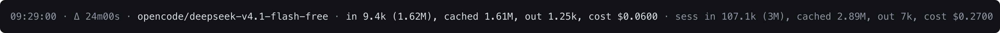
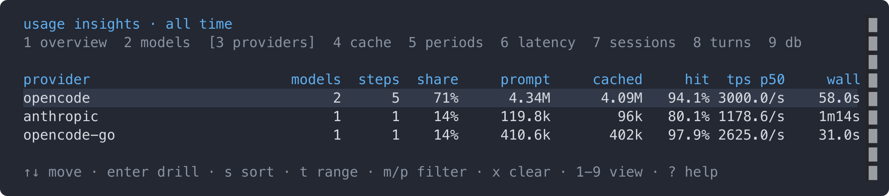

# opencode-usage-insights 📊

[](https://github.com/hugobatista/opencode-usage-insights/releases)
[](https://github.com/hugobatista/opencode-usage-insights/actions/workflows/test.yml)
[](https://github.com/hugobatista/opencode-usage-insights/actions/workflows/lint.yml)
[](https://www.npmjs.com/package/opencode-usage-insights)

**See what each turn costs.** OpenCode reports the cost of each request, but the
TUI no longer shows it. This plugin puts cost back in view in the **TUI** and in
**OpenCode Desktop**: a telemetry line after every turn, the session's running
spend and turn history, and an interactive `/usage` panel with charged cost,
list-price estimates, tokens, prompt-cache reuse and latency.



Everything stays in your OpenCode server: no prompts or responses are stored,
and the plugin sends nothing to a third party. The TUI and Desktop both read the
same recorder through an authenticated server RPC, so a client connected to a
remote server shows that server's data.

## What it does

- **The line** (`session.composer.top`): what the turn cost, the tokens and
  prompt cache behind it, when it ended, the gap since the previous prompt, the
  model and configured provider, and warnings when the prompt cache or the
  provider changed. It belongs to finished work, so it stays hidden while a
  turn is running.
- **The `/usage` panel**: nine keyboard-driven views — `overview`, `models`,
  `providers`, `cache`, `periods`, `latency`, `sessions`, `turns`,
  `db` — over five ranges (`session`, `today`, `7d`, `30d`, `all`), with
  drill-downs, sorting, filters and state remembered between openings.
  `/usage models 7d`, `/usage providers 30d`, `/usage turns 7d`.
- **The Desktop header badge and panels**: a spend badge in the session header,
  next to the peak/off-peak badge; clicking it opens **Turns insights**, the
  session history. **Usage insights** holds the nine views and opens from
  `/usage`. The Desktop window never opens SQLite: the server's worker serves
  the panels and history over RPC.
- **The session sidebar** (TUI): the session's running spend and its last turns, in
  the same buckets as the line. Three lines per turn — when, through which
  provider and how long it took, the prompt volumes, then `hit · tok/s · cost`
  — plus the model at both ends of the block and on any turn that changed it,
  so the history reads whether it is the whole session or a window of a long
  one: `16:54 opencode-go · 1m14s` / `deepseek-v4.1-flash max` /
  `in 1.7k (427.3k) · out 1.06k` / `hit 99.7% · 1.2k/s · $0.0006`. The duration
  is the turn's wall time, first request to last completion: tool waits inside
  the turn count, idle time between turns does not.
- **The record** (server part): every assistant step with tokens, charged cost,
  the list-price estimate when the host reported `$0`, timings, finish reason,
  the configured provider and model it ran through, and its session and parent
  ids; prompts, session lifecycle and compaction events too; and the host's
  `session.usage.recorded` for compactions and title generations, which have no
  assistant step of their own.
- **Portable data** (from a checkout): `bun run report --ndjson` exports the
  whole database, and `--import` merges it back on another machine.
- **Observational by design**: the plugin never rewrites prompts, requests or
  responses, and a failure inside the recorder is swallowed — telemetry can
  never interrupt a session.

## Requirements

- **OpenCode V2** (`>=2.4.2`). The Desktop GUI part uses the V2 GUI plugin API
  (`./gui-experimental`), introduced in the 2.4 line. The server and TUI parts
  run on the same server that records the sessions.
- [Bun](https://bun.sh) to install dependencies (development only).

| | |
| --- | --- |
| **OS** | Linux, macOS and Windows. The database lives in the per-user state directory of each (table below); `test/paths.test.ts` asserts the path rules of all three from any machine, and `bun run check:platform` exercises the data layer — paths, database, recorder, queries, panel assembly, dump round-trip, file permissions — on the OS it runs on. CI runs the whole suite (including the TUI render tests) on Linux. |
| **Runtime** | Bun, the runtime OpenCode ships with. SQLite comes from `bun:sqlite`: there is no native module to build and nothing to compile on install. |
| **Desktop** | OpenCode Desktop 2.4+. The GUI is one CommonJS bundle (`dist/gui-experimental.cjs`) that uses the app's shared Solid, Effect and OpenCode client modules; it never opens SQLite. |

## Install

The plugin is published on npm as `opencode-usage-insights`.

```sh
opencode plugin add opencode-usage-insights
```

This adds one entry to the global `opencode.json(c)`. That entry loads every
part of the package: the server recorder and RPC, the TUI contributions, and the
Desktop GUI. A TUI-only package goes in `~/.config/opencode/cli.json`; this
plugin has a server part, so `opencode.json(c)` is enough.

> **Desktop reads only `opencode.json(c)`.** If you added the plugin to
> `~/.config/opencode/cli.json` for the TUI, add it to `opencode.json(c)` as
> well; otherwise the Desktop side never loads. Do not keep it in both places:
> one entry in `opencode.json(c)` covers the TUI and the Desktop.

If you prefer to edit the configuration yourself:

```jsonc
// ~/.config/opencode/opencode.jsonc
{
  "$schema": "https://opencode.ai/config.json",
  "plugins": ["opencode-usage-insights"]
}
```

To pass [options](#configuration), use the object form:

```jsonc
{
  "plugins": [
    { "package": "opencode-usage-insights", "options": { "sidebarTurns": 8 } }
  ]
}
```

Or register a local checkout. Point at the **package root**, not `src/`: the
loader reads the package `exports`, which resolve the server, TUI, RPC and GUI
parts. Build once before loading it, and rebuild after source changes:

```sh
cd /home/you/code/projects/opencode-usage-insights
bun install
bun run build
```

```jsonc
// ~/.config/opencode/opencode.jsonc
{ "plugins": [{ "package": "/home/you/code/projects/opencode-usage-insights" }] }
```

For GUI development, keep `bun run dev:gui` running in another terminal; each
rebuild reloads the Desktop GUI in every window without restarting the server.
Configuration changes reload on their own; after changing server or TUI source,
restart the background service with `opencode service restart`.

Send a prompt to verify: the telemetry line appears above the composer when the
turn finishes, and `/usage` (alias `/insights`) opens the panel.

## The line

```text
14:32:07 · Δ 3m12s · opencode-go/deepseek-v4.1-flash max · in 85.4k (1.62M), cached 1.53M, out 3.7k, cost $0.21 · sess in 2.1M (14.5M), cached 12.4M, out 88k, cost $1.90 · ⚠ cache expired (−11.7k)
```

| Segment | Meaning |
| --- | --- |
| `14:32:07` | When the response ended (`completed`, else `streamed`, else `created`). |
| `Δ 3m12s` | Time since the previous prompt of the same session. |
| `opencode-go/deepseek-v4.1-flash max` | The identity of the turn: the configured provider the model ran through and the model (the variant as a trailing word; `fields.model`/`fields.variant` hide either). Yellow with `changed` when the provider differs from the previous prompt, `model changed` when only the model does. |
| `in 85.4k (1.62M), cached 1.53M, out 3.7k, cost $0.21` | `in` is the uncached part of the prompt (fresh input + cache writes), the parenthesised value the whole prompt — shown only when the two differ — `cached` its cached part, `out` everything generated (visible output + reasoning), and `cost` what the turn was billed. With several steps the segment reads `3 steps · …` and reports the step the turn ended with (`latest`) for the tokens, while the cost is always the turn's own — every step is paid for; `turnTotals: "sum"` adds every step's tokens instead. |
| `cost $0.21` | Money, not tokens: a turn sums every step's cost whatever the token view shows. A cost of zero is left out, so a free model reads as free. `fields.cost: false` hides it. |
| `cost ≈ $0.21` | A **list-price estimate**, not money charged. When the host reports `cost: 0` for a paid model (OpenCode 2.2.0+ with an OpenCode Go subscription), the plugin prices the step from the host's model list. A turn mixing covered and paid steps keeps both parts visible: `cost $0.12 + ≈ $3.40`. `pricing: "off"` hides estimates everywhere; `fields.cost: false` hides both. |
| `sess in 2.1M (14.5M), cached 12.4M, out 88k, cost $1.90` | The session totals: tokens and charged money come from the host (including its compaction and title generations), and the list estimate comes from the steps the plugin recorded. A Go session reads `cost ≈ $3.40`; a session mixing charged and covered steps keeps both parts, `cost $0.12 + ≈ $3.40`. |
| `⚠ cache expired (−11.7k)` | Yellow. The prompt cache read fell by that many tokens against a comparable previous step; `×N` when several steps in the turn lost cache. |

The turn segment carries no label by default — the numbers are the turn's, and
`sess` marks the session's; `labels.turn` (e.g. `"turn"`) brings a prefix back.

`≈` is an estimate at the host's list price, never a charge. It appears when
OpenCode reports a step at `$0` — subscription-covered Go requests, or a provider
that stopped reporting a cost — and the host's model list still has a price. A
genuinely free model has no price and therefore no estimate; it is recorded as
known free rather than as an unknown price. The estimate is stored per step, so
the line's `sess` segment, the panel, the sidebar, the NDJSON export and the CLI
report all show the same number. The `db` view lists how many `$0` steps still
lack one; `e` backfills them using today's model list.

A turn is every consecutive assistant step after a prompt. Compaction, shell,
`idle` and info messages do not split a turn; `user`, `synthetic` and `system`
messages do. From a checkout, `bun run demo` prints one example per case,
including the streaming one and both turn-total views.

## OpenCode Desktop

The Desktop app loads the package's `./gui-experimental` bundle in every window.
The GUI plugin API is experimental in the 2.4 line; the bundle is tested against
OpenCode Desktop 2.4.2. The window is Electron/Chromium: it has no Bun, no
`bun:sqlite` and no Node filesystem.

If the plugin was already installed before it gained the GUI part, restart the
background service once (`opencode service restart`) and reopen the Desktop
window. The plugin inventory caches the package's parts; a config reload may
reload the server entry without noticing the new `./gui-experimental` export. The recorder, the database and the worker stay in the server; the
window reads them through the same RPC the TUI uses.

### The cost badge

In the session header, next to the peak/off-peak badge, the usage insights badge
shows the finished turn's spend (`$0.0210` or `≈$0.0210`):

```text
$0.0210
```

Hovering shows the full telemetry line. Clicking it opens **Turns insights**.
The badge follows the TUI line and hides while a turn is running; it reappears
with the final amount. The `fields`, `labels`, `turnTotals` and `pricing`
options apply to both.

### Usage insights and Turns insights

`/usage` (and the hidden `/insights` alias) opens the **Usage insights** panel
in the side region. It has the same nine views, five ranges, drill-downs,
sorting and filters as the TUI, plus the database view's maintenance buttons.
The **Turns insights** tab and `/usage turns` show the session history. Both
panels have the inverse shortcut: **Usage insights** has an **Open turns
insights** footer button, and **Turns insights** has **Open usage insights**.

The TUI's always-visible sidebar has no Desktop slot. The Desktop equivalents
are:

| Where | What it shows |
| --- | --- |
| Session header badge | The turn spend and the full line on hover; click opens Turns insights. |
| Turns insights tab / `/usage turns` | The complete history, with the session/all-sessions scope. |
| Side panel `+` menu | **Usage insights** and **Turns insights** launchers. |

The panel state is stored separately from the TUI: opening the Desktop panel
does not move the TUI panel, and vice versa.

### The server side

The server part now also registers the usage RPC and starts a **database
worker**. The worker owns a read-only SQLite connection for the panel and the
turn history, and opens a short write connection for `prune`, `vacuum` and
`backfill`. Panel queries therefore never block the agent's event loop, and the
TUI no longer opens SQLite either: it works against a local or a remote server.

The worker is started lazily on the first usage request (the panel, the history or the header badge estimate). If it cannot start
(for example in a development runtime), the server falls back to an in-process
service and logs it; the plugin still works, but the fallback shares the
server's event loop.

### Desktop options

```jsonc
{
  "plugins": [
    {
      "package": "opencode-usage-insights",
      "options": {
        "maintenance": false,
        "exposePaths": false,
        "sidebarTurns": 8
      }
    }
  ]
}
```

| Option | Default | Meaning |
| --- | --- | --- |
| `maintenance` | `true` | Allow the RPC to prune, vacuum and backfill. Set `false` on servers reachable from other machines; the TUI and Desktop then hide the maintenance rows and refuse the actions. |
| `exposePaths` | `false` | Return the absolute database path in the `db` view. The default returns only the file name. |
| `sidebarTurns` | `8` | Turns shown in the TUI sidebar and the Desktop Turns insights tab. |
| `panel` | `true` | Register the `/usage` panel and command. |
| `sidebar` | `true` | TUI-only: show the turn history in the session sidebar. The Desktop history is the Turns insights tab. |

The `db` option is server-side: clients never open the file. The database path
is resolved by the server, relative to the server process when it is relative.

### Remote servers

The TUI and Desktop call the RPC on the server that owns the session. A TUI
connected to a remote server shows that server's usage; the Desktop GUI is
loaded from its own background server, but the panel targets the session's
server. The plugin's server part must be installed and enabled on that server.
If it is not, the panel explains that usage data is unavailable.

## How costs are calculated

**Charged money is never recalculated by the plugin.** `steps.cost` is what the
host reports for the step (possibly `0` for an OpenCode Go subscription). When
that number is `0` or missing and the model has a price in the host's model
list, the plugin computes a **list-price estimate** and stores it in
`steps.list_cost`. Prices are USD per 1,000,000 tokens.

The price source is the model list exposed by the OpenCode process that is
currently serving the session, already resolved by the host (provider config,
overrides, Zen/Go pricing):

| Surface | Where the price comes from |
| --- | --- |
| Server recorder | `ctx.model.list()` → `ModelInfo.cost` |
| Live turn / backfill | `ctx.data.location.model.list(ctx.location)` → `ModelInfo.cost` |
| Panel, sidebar, NDJSON, CLI report | stored `steps.list_cost` |
| `sess` segment | `SUM(list_cost)` from the plugin database, served over the RPC |

The plugin does **not** read `~/.cache/opencode/models.json`, does **not** use
`opencode models` for prices (it lists model IDs only), and makes no network
call of its own. Each `ModelInfo` carries the prices as
`cost: Array<{ input, output, cache: { read, write }, tier? }>` in USD per
1,000,000 tokens.

The estimate uses the host's own fallback formula:

```text
input       fresh (uncached) prompt tokens
cache.read  prompt tokens read from the provider cache
cache.write prompt tokens written to the provider cache
output      visible output tokens
reasoning   reasoning tokens

prompt = input + cache.read + cache.write
cost   = (input * inputPrice
          + (output + reasoning) * outputPrice
          + cache.read * cacheReadPrice
          + cache.write * cacheWritePrice) / 1_000_000
```

Reasoning is billed at the output price. For models with context tiers, the
tier applies only when the whole prompt is **strictly greater** than the tier
size; at exactly the threshold the untiered price applies. An unknown model or
no applicable price means no estimate; an all-zero price means the model is
known to be free.

The buckets behind the line are the same ones the estimate uses, but folded for
display:

```text
in     = input + cache.write   (the uncached part of the prompt)
cached = cache.read
out    = output + reasoning
prompt = in + cached
```

`list_cost` has three meanings: `NULL` means the step was charged or its price
is unknown; `0` means the model is known to be free; a positive value is the
estimate. That is why a free model reads as `$0`, while an older model the
host's model list no longer contains stays without a price.

A worked example, using the prices of `opencode-go/deepseek-v4.1-flash`
(`input 0.15`, `output 0.6`, `cache.read 0.003`):

```text
2,591 × 0.15 + (564 + 3,239) × 0.6 + 514,944 × 0.003
= 4,215.282 per 1,000,000 tokens
= $0.004215282
```

### Compactions and titles

The host also reports usage with no assistant step behind it:
`session.usage.recorded` with `source: "compaction"` or `source: "title"`. It is
part of the session's own `cost`, and the plugin stores it in the `usage` table,
keyed by the host event ID so a replay never counts twice.

Its cost is added to the **overview**, **periods** and **sessions** totals — the
same money the host already includes in the session. The `models`, `providers`
and `turns` rows stay step-based: the host's non-step usage record carries no
model, so attributing the money to one would invent an identity. The overview
shows the part as an `other` row, and a session row names it under its title.

This is host money, not a list-price estimate, so `pricing: "off"` does not hide
it. A database written by an older plugin is healed at open: the stored
compaction events already carry `cost` and `tokens`, and a migration recovers
them. Title usage recorded before the upgrade was never stored anywhere and
stays missing; the line's `sess` segment (which reads the host's own session
total) keeps covering the whole session meanwhile.

What each surface shows:

| Situation | Line | Panel |
| --- | --- | --- |
| Charged | `cost $0.12` | `$0.12` |
| Subscription-covered (host `0`, host model price known) | `cost ≈ $3.40` | `≈$3.40` |
| Mixed (some charged, some covered) | `cost $0.12 + ≈ $3.40` | overview `$0.12 + ≈ $3.40`; table cell `≈$3.52` (charged + estimate) |
| Compaction/title (host `session.usage.recorded`) | included in the host's `sess` total | overview `other $0.0042`; session and period cost include it |
| Known free model | cost omitted | `$0` |
| Price unknown | cost omitted | `$0` |

The **turn** estimate on the live line uses the model list the TUI currently
has. The **`sess`** segment uses the estimate recorded per step and summed for
the session, as do the panel, the sidebar, the NDJSON export and the CLI report.
If a price changes after a step is recorded, the live turn can therefore differ
from the stored history; `list_cost` freezes the price from the recording time.
The server loads its model list in the background, refreshes it on
`model.updated` and keeps the previous table if a refresh fails; the TUI
invalidates its table on the same event and refreshes it on a coarse TTL.

For a session, the charged total is the host's (including its compaction and
title generations); the estimate is `SUM(list_cost)` over the steps the plugin
recorded. The overview, periods and session rows additionally add the host's
non-step usage cost; the line's `sess` segment already has it in the host's
total, so it is not added twice. If the plugin started recording in the middle
of a session, the estimate covers only the recorded steps; the charged total
still follows the host. When the database is unavailable, the line falls back to
the host's charged total with no estimate.

The `db` view counts the `$0` steps that have no known price yet. `e` retries
them with today's host model list: free models become `0`, models still in that
list get an estimate, and models the list no longer contains stay unknown. Steps
without a provider/model or without tokens have nothing to price and are not
counted. `pricing: "off"` stops new estimates, hides stored ones everywhere and
disables the backfill, without deleting the data.

## The panel

`/usage [view] [range]` opens the panel (`/usage` alone opens the last view, or
`overview` over `all` the first time). While the panel is open it owns input, so
the prompt cannot take the command again: `escape` closes it, `f` toggles full
screen, and the palette entry (`ctrl+p` → "Usage insights") toggles it closed.
With the composer focused, `/usage` with no arguments also toggles it closed,
and any argument — including an unknown token, which is ignored — keeps it open.
There is no default key binding — the command is palette-only, so it never
shadows a key you use.



The view bar at the top names every view and brackets the active one; `?` opens
a help overlay that repeats the keys and defines every number.

### Keys

| Key | Does |
| --- | --- |
| `↑` `↓` / `j` `k` | Move the cursor; the row under it is highlighted. |
| `pageup` `pagedown` / `home` `end` | Move by ten rows / to the first or last row. |
| `enter` | Drill into the row: a model → the providers it ran through and their latency; a provider → the models it served and its latency; a session → its turns; a period → the providers of the period. In `db`, prune the steps recorded before the selected retention's cutoff date (asks first). |
| `backspace` | Go back from a drill-down. |
| `1`–`9` / `[` `]` | Pick a view (`9` is `db`) / cycle views. |
| `t` / `shift+t` | Next / previous range. |
| `s` / `shift+s` | Cycle the sort column / reverse it. |
| `b` | `periods` bucket: day → week → month. |
| `a` | `turns` scope: this session ↔ every session. |
| `m` `p` | Filter by model or by **provider** (a picker of the values actually observed). |
| `x` | Clear the filters. |
| `r` | Re-read the database. |
| `e` | `db`: backfill list-price estimates for the `$0` steps that have none (asks first; uses today's model list). |
| `v` | `db`: compact the file, giving the space of deleted rows back. |
| `?` | Help overlay. |
| `f` / `escape` | Full screen / close. |

The view, range, sort, bucket, scope and filters are stored through the host's
durable storage, so the panel reopens where it was left.

### Views

| View | Answers |
| --- | --- |
| `overview` | Steps, sessions, prompts, `in`/`cached`/`write`/`out`, `hit`, cost (with an `other` row naming the compaction/title part), an activity sparkline, a `this session` block and a **data coverage** block (how many models and providers were observed, and how many steps lack a model or a completion — a zero elsewhere is only trustworthy when this is complete). |
| `models` | Every model with its cache (`hit` and the per-step `hit p50`), tokens, cost, the **providers it ran through** and how often it switched model or provider — with the cache a provider switch cost. Cost is assistant steps only; `enter` opens the per-provider detail. |
| `providers` | **Which configured provider ran each model**: one row per provider, with the models it served, steps, share, prompt, cached, `hit`, p50 throughput, wall time and cost. Cost is assistant steps only. `enter` lists every model it served. Steps recorded without a provider (a model that was never observed) are dimmed and cannot be drilled into. |
| `cache` | Reuse by model, losses grouped by reason (`expired`, `compaction`, `unknown`), **cache survival against idle time**, reuse kept per provider, the observed TTL bounds (`hits up to` / `drops from`) and the most recent losses. |
| `periods` | Day, week or month totals — steps, sessions, `in`, `cached`, `write`, `hit`, `out`, cost (including compaction/title usage) — with a sparkline per metric and a totals row. `enter` lists the providers of a period. |
| `latency` | Wall time, streaming window and throughput as p50/p90/p99 overall and per model (per provider when a model is filtered). `n < 5` is dimmed. |
| `sessions` | Each session with steps, prompts, tokens, `hit`, cost (including compaction/title usage, named on the detail line), its directory and how many models it used; subagent sessions are indented under their parent and rolled up. |
| `turns` | The per-prompt history: one line per finished turn, rendered exactly like the live line. Cost is assistant steps only. `a` widens it to every session, titled. |
| `db` | Where the file lives, what it holds and how much of it is old. The retention table lists, per preset (`30`/`90`/`365` days), how many steps a prune would remove and the cutoff date it prunes from — pick one with `↑`/`↓` and `enter` prunes it (a confirmation first), removing the steps' compaction/title usage with them; `v` gives the space back. It also counts the `$0` steps with no list estimate; `e` backfills them at today's list price. |

The panel sums the stored per-step buckets over the selected range, so a number
read in one place means the same in the other: `prompt` is everything the
provider saw (`cached + fresh + writes`), `in` the uncached part, `hit` is
`cached / prompt`, and `out` everything generated (visible output + reasoning).
A `cost` cell marked `≈` includes list-price estimates for steps the host
reported as `$0`; the overview and the sidebar keep a mixed total in two parts
(`$0.12 + ≈ $3.40`) so charged money is never mistaken for the estimate.

The identity of a step is the **configured provider** the model ran through —
`opencode`, `opencode-go`, `deepseek`, whatever the provider is called in the
OpenCode configuration — and the model itself. That is what every view groups
by. A gateway may route a request to another operator, but that upstream is not
observable, so it is not guessed. The same model through `deepseek` and through
`opencode-go` is two rows, two caches and two latency profiles, and a switch
between them forfeits the cache the previous one held (the switch counts and the
cache losses in the `models` view count exactly that).

`tps`/`wall`/`stream` are produced tokens per streaming second / request to
completed step / request to the last chunk. The sidebar's turn header shows the
turn's wall time — the first request to the last completed step, so any tool
wait inside the turn counts — while its rate is only the streaming window. The
sidebar's rate (per turn, and the session average on its totals) is the
**weighted** one — produced tokens divided by the summed streaming windows — so
it answers "how fast did this produce"; the `latency` view reports the p50 of
the per-step rates instead, which answers "how fast is a typical step". A
switch from one step to the next is not by itself a fault — moving to another
model or provider is a deliberate choice — so the `models` view pairs the count
with the cache the switch actually cost, which only a provider switch can: two
models never share a cache to lose. The panel's `?` overlay defines every
number in place.

## Configuration

Options apply to all three parts (each side reads the ones it needs):

| Option | Default | Meaning |
| --- | --- | --- |
| `enabled` | `true` | `false` disables that side completely — no line, no panel, no recording. |
| `db` | per-OS state path | SQLite path override, resolved by the **server**. The TUI and Desktop read it through the RPC and never open the file. |
| `turnTotals` | `"latest"` | How the turn segment counts prompt usage: `latest` shows the prompt size the turn ended with; `sum` adds every step of the turn. |
| `pricing` | `"auto"` | `"off"` disables list-price estimates everywhere: no new `list_cost` records, no `≈` on the line, in the panel or in the sidebar, and no historical backfill. Charged money is unaffected. |
| `sidebar` | `true` | TUI-only: show the session summary and the per-prompt history in the session sidebar. The Desktop history is the Turns insights tab. |
| `sidebarTurns` | `8` | How many turns the history shows. The host sidebar scrolls; raise it for a longer history. |
| `panel` | `true` | Show the `/usage` statistics panel and its command in the TUI and Desktop. `false` keeps the line and the history. |
| `maintenance` | `true` | Allow the RPC to prune, vacuum and backfill. Set `false` on servers reachable from other machines. |
| `exposePaths` | `false` | Return the absolute database path in the `db` view; the default returns only the file name. |
| `fields` | see below | Toggle line segments. |
| `labels` | see below | Override line labels (the plugin is English-only by default). |

### Fields and labels

```jsonc
{
  "options": {
    "fields": { "clock": true, "delta": true, "model": true, "variant": true, "turn": true, "session": true, "reasoning": false, "cost": true, "cacheExpiry": true },
    "turnTotals": "latest",
    "labels": { "delta": "Δ", "turn": "", "session": "sess", "step": "step", "steps": "steps", "input": "in", "cached": "cached", "output": "out", "reasoning": "reason", "cost": "cost", "estimate": "≈", "cacheExpired": "cache expired", "providerChanged": "changed", "modelChanged": "model changed" }
  }
}
```

`fields: { "clock": false, "delta": false, "session": false }` turns the line
into a pure `provider/model · turn …` reading.

## Database and privacy

The recorder writes to the per-user state directory:

| OS | Path |
| --- | --- |
| Linux / other | `$XDG_STATE_HOME/opencode/opencode-usage-insights/usage.db` (default `~/.local/state/opencode/opencode-usage-insights/usage.db`) |
| macOS | `~/Library/Application Support/opencode/opencode-usage-insights/usage.db` |
| Windows | `%LOCALAPPDATA%\opencode\opencode-usage-insights\usage.db` |

`OPENCODE_USAGE_INSIGHTS_DB=/path/to/usage.db` overrides the path, and the `db`
option overrides both. The file is private to the user: its directory is created
`0700` and the file `0600` (POSIX), re-applied on every open. The TUI and the
Desktop GUI never open the file. They call the usage RPC; the server's worker
holds a read-only connection for the panel and the history, so a view can never
write, migrate or take the recorder's lock. Prune, backfill and compact use a
separate short-lived writer inside the worker. The server part applies schema
migrations on open; after an upgrade, start it once before opening the panel if
the file predates the new schema.

Per step the database holds tokens, charged cost, the list-price estimate when
the host reported `$0`, timings, finish reason, the configured provider and the
model it ran through, and the session title and working directory. **Prompts and
responses are not stored**, and nothing leaves the machine. The schema, the
indexes, the identity rules and the security notes live in
[docs/internals.md](docs/internals.md).

### Security and remote servers

The usage RPC is served by the OpenCode server and inherits its authentication.
It is not a new unauthenticated endpoint, but it is a new authenticated surface:
any client that can call the server API can call it, and the RPC handler has no
caller identity (`RpcCallContext` exposes only cancellation and declared
errors). The plugin therefore applies least privilege at the surface:

- **Read-only by default for queries.** `panel`, `turns`, `listCost`, `filters`
  and `dbInfo` run on the worker's read-only SQLite connection. The only writes
  are `prune`, `vacuum` and `backfill`, gated by `maintenance` and an explicit
  confirmation.
- **No free-form access.** There is no SQL, path, import or export method. Inputs
  are validated by JSON Schema with closed objects, enums, length limits and
  numeric clamps; the service validates them again. SQL is parameterized.
- **Minimal output.** The RPC returns usage metadata — session titles,
  directories, models, providers, tokens, costs and the database shape — never
  prompts or responses. Database paths are returned as a file name unless
  `exposePaths: true`.
- **Availability.** The worker keeps panel queries off the server's event loop;
  the client queue is bounded and the worker has a watchdog. Generic errors are
  returned; details stay in the server log.

For a server reachable from another machine, set `maintenance: false` unless you
need the maintenance buttons there. The RPC is only as protected as the server:
do not expose an OpenCode server without its password/auth. The usage database
is per server user; every authenticated client on that server sees the same
sessions and aggregates. If you need per-user or per-tenant isolation, do not
expose the RPC until the database carries that dimension.

## CLI report

From a checkout, the database can be read without opening the TUI:

```sh
bun run report                          # overview over all time
bun run report models 7d                # one view, one range
bun run report all                      # every view
bun run report providers --model deepseek-v4.1-flash
bun run report periods --granularity month
bun run report models --provider opencode-go
bun run report --no-estimates           # charged money only, like pricing: "off"
bun run report --json                   # raw rows and every analysis, for scripting
bun run report --ndjson > backup.jsonl  # export the whole database
bun run report --import backup.jsonl    # merge an export (idempotent)
bun run report --help
```

The views come from the same `buildPanel` the TUI and the Desktop render, so the
terminal and the panels never drift apart. Run this on the server that owns the
database; it is the local CLI counterpart to the RPC. `--width`,
`--granularity`, `--model`, `--provider`, `--sort` and `--asc` mirror what the
panel's controls do.

## Development

```sh
bun install
bun run typecheck    # server, TUI and the separate Desktop DOM typecheck
bun test             # pure logic + database + TUI harness + worker/RPC tests
bun run build        # dist/index.js, tui.js, rpc.js, stats-worker.js, gui-experimental.cjs
bun run check:package
bun run demo         # print the line and every view from a seeded database
bun run docs:images  # re-render docs/images/*.png (needs ImageMagick)
bun run dev:gui      # vite build --watch for the Desktop part
```

For the Desktop development loop, point the local plugin at the package root
(built once) and keep `bun run dev:gui` running: each GUI rebuild reloads the
bundle in every Desktop window. Server or TUI source changes still need
`opencode service restart`.

- `src/core.ts`, `src/line.ts`, `src/panel-data.ts` and `src/stats/` are pure:
  turn accounting, the host-shape adapter, the view models, and the database,
  queries and analysis layer. No host imports, so they are unit-testable without
  a TUI runtime.
- `src/text.ts` — text hygiene and the token shape a provider id is validated
  against.
- `src/recorder.ts` — the event-stream state machine that fills the database.
- `src/rpc.ts`, `src/rpc-client.ts` — the shared RPC contract and its typed
  client wrapper.
- `src/service.ts`, `src/stats-worker.ts`, `src/stats-client.ts` — the database
  service, the worker that runs it off the server's event loop, and the bounded
  server-side client with its in-process fallback.
- `src/panel-build.ts`, `src/panel.tsx`, `src/sidebar.tsx` — server-side panel
  assembly, the TUI panel component, and the TUI sidebar contribution.
- `src/gui.tsx`, `src/gui/` — the Desktop entry, header badge, panels, line
  helpers, CSS, icon and copy.
- `src/index.ts`, `src/tui.tsx` — the server (recorder + RPC + worker) and TUI
  parts.
- `scripts/` — the demo, report, bench, platform-check, package-check and
  documentation-image CLIs, plus the Bun/Vite build.

See [CONTRIBUTING.md](CONTRIBUTING.md) for the ground rules and review
expectations, and [docs/internals.md](docs/internals.md) for the database
design, performance rules and how the TUI side is tested.

## License

MIT — see [LICENSE](./LICENSE). Author: Hugo Batista
(<https://github.com/hugobatista>).
