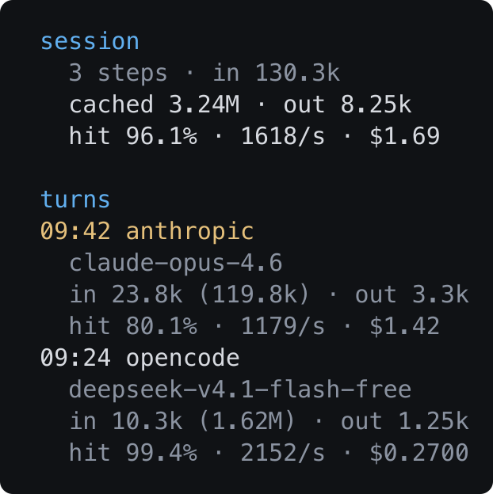
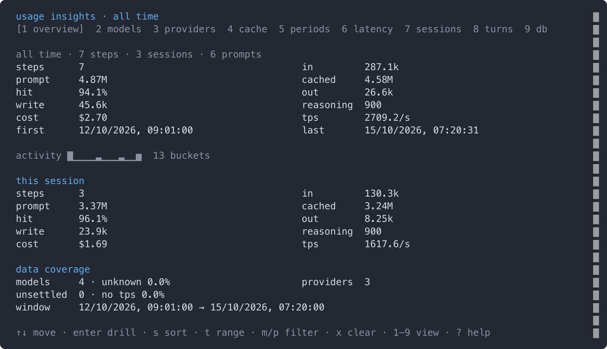
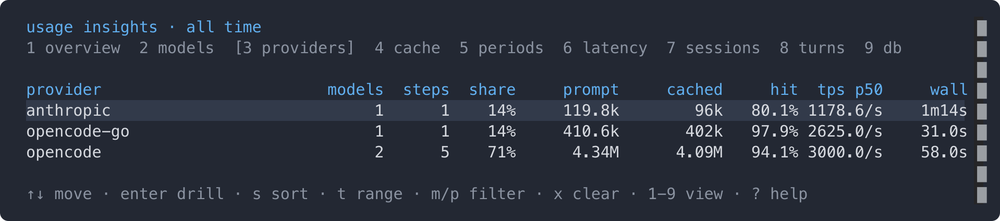
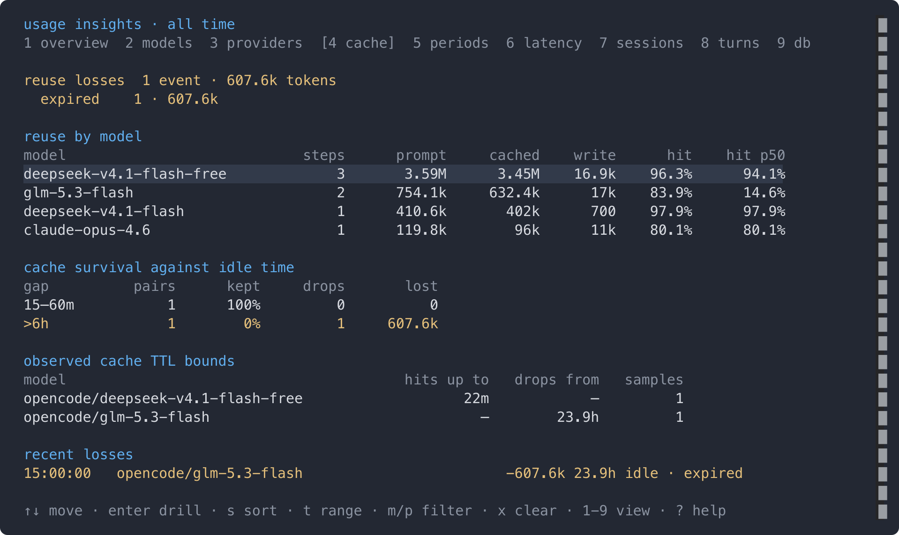

# Demo output

Generated with `bun run demo 100` against a seeded throwaway database (times
render in the local timezone). `bun run docs:images` captures the screenshots
from the same database, through the same components the TUI renders.

## The line


## The sidebar



## The panel







## Full output

```text
turn · prompt cache survived (the provider and model that ran the turn)
────────────────────────────────────────────────────────────────────────────────────────────────────
09:29:00 · Δ 24m00s · opencode/deepseek-v4.1-flash-free · in 9.4k (1.62M), cached 1.61M, out 1.25k, cost $0.0600 · sess in 107.1k (3M), cached 2.89M, out 7k, cost $0.2700

turn · prompt cache expired after an idle gap
────────────────────────────────────────────────────────────────────────────────────────────────────
15:09:00 · Δ 1d0h · opencode/glm-5.3-flash · in 63.7k (76.1k), cached 12.4k, out 4.8k, cost $0.4400 · sess in 121.7k (754.1k), cached 632.4k, out 9.9k, cost $0.7600 · ⚠ cache expired (−607.6k)

turn · provider changed (opencode → anthropic)
────────────────────────────────────────────────────────────────────────────────────────────────────
09:52:00 · Δ 17m00s · anthropic/claude-opus-4.6 · changed · in 12.8k (108.8k), cached 96k, out 3.3k, cost $1.42 · sess in 130.3k (3.37M), cached 3.24M, out 8.25k, cost $1.69

turn · tool-call loop, latest view (the prompt size the turn ended with)
────────────────────────────────────────────────────────────────────────────────────────────────────
21:27:00 · opencode/deepseek-v4.1-flash-free · 3 steps · in 1.02k (292.6k), cached 291.6k, out 1.49k, cost $0.0900 · sess in 107.1k (3M), cached 2.89M, out 7k, cost $0.2700

turn · tool-call loop, sum view (turnTotals: "sum" — every step of the turn)
────────────────────────────────────────────────────────────────────────────────────────────────────
21:27:00 · opencode/deepseek-v4.1-flash-free · 3 steps · in 2.67k (875.2k), cached 872.6k, out 2.23k, cost $0.0900 · sess in 107.1k (3M), cached 2.89M, out 7k, cost $0.2700

turn · response still streaming (no line until the response ends)
────────────────────────────────────────────────────────────────────────────────────────────────────
(no line yet)

sidebar (the session's totals, then the turns — three lines each, plus the model at both ends of the block and on every change)
────────────────────────────────────────────────────────────────────────────────────────────────────
session
  3 steps · in 130.3k
  cached 3.24M · out 8.25k
  hit 96.1% · 1618/s · $1.69

turns
09:42 anthropic
  claude-opus-4.6
  in 23.8k (119.8k) · out 3.3k
  hit 80.1% · 1179/s · $1.42
09:24 opencode
  deepseek-v4.1-flash-free
  in 10.3k (1.62M) · out 1.25k
  hit 99.4% · 2152/s · $0.2700

/usage overview
────────────────────────────────────────────────────────────────────────────────────────────────────
all time · 7 steps · 3 sessions · 6 prompts
steps      7                                      in         287.1k
prompt     4.87M                                  cached     4.58M
hit        94.1%                                  out        26.6k
write      45.6k                                  reasoning  900
cost       $2.70                                  tps        2709.2/s
first      12/10/2026, 09:01:00                   last       15/10/2026, 07:20:31

activity █▁▁▁▁▁▁▁▁▁▃▁▁▁▁▁▁▁▃▁▁▁▁▁▆  25 buckets

this session
steps      3                                      in         130.3k
prompt     3.37M                                  cached     3.24M
hit        96.1%                                  out        8.25k
write      23.9k                                  reasoning  900
cost       $1.69                                  tps        1617.6/s

data coverage
models     4 · unknown 0.0%                       providers  3
unsettled  0 · no tps 0.0%
window     12/10/2026, 09:01:00 → 15/10/2026, 07:20:00

/usage models
────────────────────────────────────────────────────────────────────────────────────────────────────
model                       steps    prompt    cached     hit      out     cost providers
deepseek-v4.1-flash             1    410.6k      402k   97.9%     2.1k  $0.0700 opencode-go
                           p50 hit 97.9% · 1 switch (1 provider)
claude-opus-4.6                 1    119.8k       96k   80.1%     3.3k    $1.42 anthropic
                           p50 hit 80.1% · 1 switch (1 provider)
glm-5.3-flash                   2    754.1k    632.4k   83.9%     9.9k  $0.7600 opencode
                           p50 hit 14.6%
deepseek-v4.1-flash-free        3     3.59M     3.45M   96.3%    11.3k  $0.4500 opencode
                           p50 hit 94.1%

/usage providers
────────────────────────────────────────────────────────────────────────────────────────────────────
provider                        models  steps  share     prompt     cached     hit  tps p50     wall
anthropic                            1      1    14%     119.8k        96k   80.1% 1178.6/s    1m14s
opencode-go                          1      1    14%     410.6k       402k   97.9% 2625.0/s    31.0s
opencode                             2      5    71%      4.34M      4.09M   94.1% 3000.0/s    58.0s

/usage cache
────────────────────────────────────────────────────────────────────────────────────────────────────
reuse losses  1 event · 607.6k tokens
  expired    1 · 607.6k

reuse by model
model                            steps      prompt     cached    write      hit    hit p50
deepseek-v4.1-flash-free             3       3.59M      3.45M    16.9k    96.3%      94.1%
glm-5.3-flash                        2      754.1k     632.4k      17k    83.9%      14.6%
deepseek-v4.1-flash                  1      410.6k       402k      700    97.9%      97.9%
claude-opus-4.6                      1      119.8k        96k      11k    80.1%      80.1%

cache survival against idle time
gap          pairs      kept     drops       lost
15–60m           1      100%         0          0
>6h              1        0%         1     607.6k

observed cache TTL bounds
model                                        hits up to   drops from   samples
opencode/deepseek-v4.1-flash-free                   22m            –         1
opencode/glm-5.3-flash                                –        23.9h         1

recent losses
15:00:00   opencode/glm-5.3-flash                        −607.6k 23.9h idle · expired

/usage periods
────────────────────────────────────────────────────────────────────────────────────────────────────
per day · 4 periods · 7 steps · hit 94.1%
steps   █▃▃▆
cached  █▂▁▃
cost    █▂▃▂
period         steps    sess      prompt     cached     hit       out      cost
2026-10-15         2       1      747.1k       712k     95%      8.4k   $0.2500
2026-10-14         1       1       85.1k      12.4k     15%      4.8k   $0.4400
2026-10-13         1       1        669k       620k     93%      5.1k   $0.3200
2026-10-12         3       1       3.37M      3.24M     96%     8.25k     $1.69

total              7       4       4.87M      4.58M     94%     26.6k     $2.70

/usage latency
────────────────────────────────────────────────────────────────────────────────────────────────────
wall       p50  58.0s     p90  1m28s     p99  1m28s     n 7
stream     p50  1.2s      p90  2.8s      p99  2.8s
throughput p50  2642.9/s  p90  5250.0/s  p99  5250.0/s

wall = request to completed · stream = request to last chunk · throughput = output+reasoning tokens…

by group
group                n wall p50 wall p90   stream  tps p50  tps p90     cost
claude-opus-4.6      1    1m14s    1m14s     2.8s 1178.6/s 1178.6/s    $1.42
deepseek-v4.1-f…     1    31.0s    31.0s    800ms 2625.0/s 2625.0/s  $0.0700
glm-5.3-flash        2    58.0s    1m01s     1.1s 3000.0/s 4636.4/s  $0.7600
deepseek-v4.1-f…     3    52.0s    1m28s     1.2s 2642.9/s 5250.0/s  $0.4500
n < 5 is dimmed: too few samples to compare

/usage sessions
────────────────────────────────────────────────────────────────────────────────────────────────────
title                                  steps      prompt     cached     hit       out      cost
Refactor the recorder                      3       3.37M      3.24M     96%     8.25k     $1.69
  /code/opencode-usage-insights · 2 models
Fix the cache regression                   2      754.1k     632.4k     84%      9.9k   $0.7600
  /code/opencode-usage-insights
Docs pass                                  2      747.1k       712k     95%      8.4k   $0.2500
  /code/opencode-usage-insights · 2 models

/usage turns
────────────────────────────────────────────────────────────────────────────────────────────────────
6 turns · newest first
Refactor the reco…  09:24:20 · opencode/deepseek-v4.1-flash-free · 2 steps · in 10.3k (1.62M), cach…
Refactor the reco…  09:42:14 · Δ 40m00s · anthropic/claude-opus-4.6 · changed · in 23.8k (119.8k),…
Fix the cache reg…  15:03:01 · opencode/glm-5.3-flash · in 49k (669k), cached 620k, out 5.1k, cost…
Fix the cache reg…  15:00:58 · Δ 23h58m · opencode/glm-5.3-flash · in 72.7k (85.1k), cached 12.4k,…
Docs pass  07:01:28 · opencode/deepseek-v4.1-flash-free · in 26.5k (336.5k), cached 310k, out 6.3k,…
Docs pass  07:20:31 · Δ 20m00s · opencode-go/deepseek-v4.1-flash · changed · in 8.6k (410.6k), cach…

/usage db
────────────────────────────────────────────────────────────────────────────────────────────────────
/tmp/usage-insights-demo-mFDbHx/usage.db
0.0 MB + 0.4 MB wal · schema v9

what it holds
  sessions    3 rows
  prompts     6 rows
  events      0 rows
  steps       7 rows
  window      12/10/2026 → 15/10/2026

clean up
  ↑↓ pick a retention · enter prunes the steps older than it (asks first) · v gives the space back
keep              prunes older than
30 days          0 steps 16/09/2026
90 days          0 steps 18/07/2026
365 days         0 steps 16/10/2025
```
